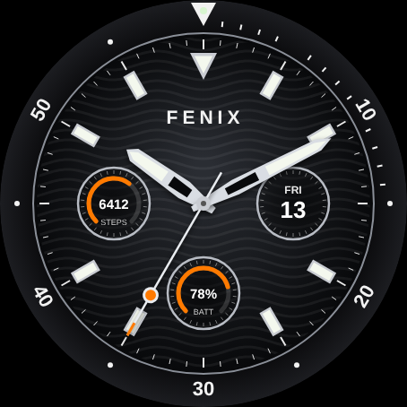

# JKWFenix

A dive-style analogue watch face for the Garmin fenix 8 AMOLED 47mm, written in Monkey C for Connect IQ.



*Design mockup. On the watch, Garmin's own fonts are used.*

## Design

- Black dial with a wave pattern, and FENIX under 12
- Dive bezel with a 0 to 60 minute scale; 20, 30 and 40 are turned to read the right way up
- Baton hour markers with lume, and a triangle at 12
- Skeleton sword hour and minute hands with lume tips
- Seconds hand with a bright orange dot, shown after you raise your wrist and hidden when the watch dims to save battery
- Three small dials:
  - 3 o'clock: date (day and number)
  - 6 o'clock: battery percentage with an orange gauge, turning red below 20%
  - 9 o'clock: step count with an orange gauge showing progress to your daily goal
- Always-on display: outlined hands and dim markers only, moved slightly each minute to protect the AMOLED screen

## Building and testing

1. Install the [Connect IQ SDK Manager](https://developer.garmin.com/connect-iq/sdk/), then download the latest SDK and the **fenix 8 47mm** device.
2. Install Visual Studio Code and the **Monkey C** extension by Garmin.
3. Press Ctrl+Shift+P (Cmd+Shift+P on a Mac) and run *Monkey C: Generate a Developer Key* (once only).
4. Open this folder in VS Code and press **F5** to run it in the simulator.
5. In the simulator, use *Settings > Low Power Mode* to check the always-on view, and *File > View Burn-in* to check it passes Garmin's AMOLED burn-in test.

## Installing on your watch

1. Run *Monkey C: Build for Device* and choose the fenix 8 47mm. This creates a `.prg` file.
2. Connect the watch to your computer by USB.
3. Copy the `.prg` file into the `GARMIN/APPS` folder on the watch.
4. Disconnect, then on the watch go to **Watch Face** and select **JKWFenix**.

## Project layout

```
manifest.xml               App ID, type and supported device
monkey.jungle              Build configuration
source/JKWFenixApp.mc      App entry point
source/JKWFenixView.mc     All drawing logic
resources/                 App name and launcher icon
docs/preview.png           Design mockup
```
